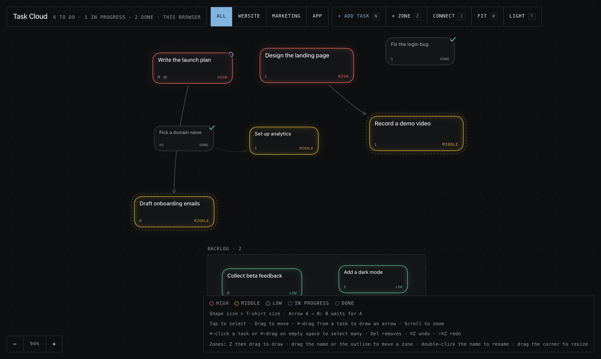

# Task Cloud

A personal task board on an infinite canvas. Tasks float, bump into each other and wobble. You link them with arrows, group them in zones and filter them by project.

One HTML file. No build, no dependencies, no account.



## Run it

Open `index.html` in a browser. Or serve the folder:

```sh
python3 -m http.server 8000   # then open http://localhost:8000
```

The first open shows an example board. Your changes are saved in the browser (localStorage).

## What it does

- **Tasks** have a title, an optional description, a priority (Low / Middle / High), a T-shirt size (XS–XL), a status (To do / In progress / Done) and a project.
- **Arrows** show order: A → B means B waits for A. The board refuses loops and duplicates.
- **Zones** are frames on the background, like in Figma. Tasks inside move with the zone. A zone can belong to a project.
- **Projects** filter the board: other projects fade and shrink but stay visible.
- **Undo** for every action, and a light and a dark theme.

## Controls

| Action | How |
| --- | --- |
| Move a task | Drag it |
| Draw an arrow | ⌘-drag from one task to another |
| Select many | ⌘-click tasks, or ⌘-drag on empty space |
| Delete | Select, then Del |
| New task / zone | `N` / `Z`, then drag to draw the zone |
| Move or resize a zone | Drag its name or outline / drag its corner |
| Rename a zone | Double-click its name |
| Undo / redo | ⌘Z / ⇧⌘Z |
| Fit, zoom, theme | `0`, scroll or pinch, `T` |

## Adding tasks from outside

On load, the page reads `inbox.json` next to it, if it exists, and adds each new task or zone once:

```json
{ "tasks": [{ "id": "t1", "title": "Write the release notes", "priority": "High", "size": "S", "project": "Website" }] }
```

---

Built with [Claude Code](https://claude.com/claude-code).
